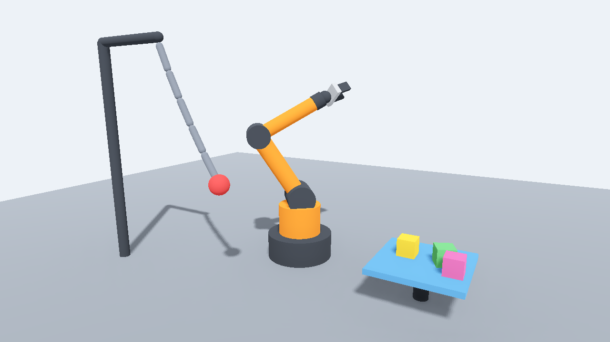

# MuJoCo for Godot

A Godot extension that brings the [MuJoCo](https://mujoco.org) physics simulator into the Godot editor: build a robot or mechanism out of nodes, or import one from an MJCF file, and simulate it with MuJoCo when the scene runs.

> **Work in progress.** This is an early, actively changing project. Node names, properties and saved scenes may change without notice, and large parts of MuJoCo are not covered yet. It is not ready to build other projects on.



*The workcell demo (`project/demos/workcell.tscn`): an arm with five hinge joints and a sliding two-finger gripper, driven by a short script; a chain on ball joints; and loose blocks on a sprung platform.*

## Status (November 2026)

Works today:

- Building a model in the editor from `MujocoWorld`, `MujocoBody`, `MujocoGeom` and `MujocoJoint` nodes, and simulating it with MuJoCo when the scene runs.
- Primitive shapes (plane, sphere, capsule, cylinder, box); free, ball, slide and hinge joints; mocap bodies.
- Reading and driving the simulation from scripts: joint positions and velocities, applied forces, the whole state as arrays.
- Changing some properties (joint damping, stiffness and limits, geom friction) while the simulation runs, without restarting it.
- Importing MJCF files that use only the features above, with a report of what was left out and a check against MuJoCo's own result.

Not yet:

- Meshes and explicit body inertia, which most robot models need. Such models currently import but do not simulate.
- Actuators, sensors, sites, tendons, constraints and default classes.
- Any platform other than Linux x86_64.

MuJoCo simulates only the MuJoCo nodes. It does not replace Godot's own physics engine, and the two do not interact.

## Requirements

- Linux, x86_64
- [Godot](https://godotengine.org) 4.7 or newer
- A C++ compiler, Python 3 and [SCons](https://scons.org)
- MuJoCo 3.10.0, which a script downloads for you (below)

## Building

```sh
git clone --recursive https://github.com/joes-robots/godot-robotics.git
cd godot-robotics
scripts/fetch_mujoco.sh   # downloads MuJoCo into ./mujoco
scons                     # builds the extension into project/bin
```

Then open the `project/` folder in Godot.

## Trying it

- **Run the demos.** Open a scene and run it (F6).
  - `demos/workcell.tscn` is the one pictured above. Its script, `demos/workcell.gd`, shows how to read and drive joints from code.
  - `demos/shapes.tscn` is the simplest: four shapes fall onto a floor and a pendulum swings behind them.
- **Build something.** Add a `MujocoWorld` node. Under it add a `MujocoBody`, and under that a `MujocoGeom` for its shape and a `MujocoJoint` to let it move (set the joint's type to Free for a loose object). A `MujocoGeom` placed directly under the world is fixed scenery, such as a floor.
- **Import a model.** Choose Project > Tools > Import MJCF... and pick an `.xml` file. `project/tests/models/arm.xml` is a small one that imports completely. The result is saved as an ordinary scene, and a window lists anything that was left out.

## Nodes

| Node | What it is |
|---|---|
| `MujocoWorld` | One MuJoCo model and its simulation. Holds the physics options and steps the simulation. |
| `MujocoBody` | A rigid body. Its transform is its pose relative to its parent body. |
| `MujocoGeom` | A shape on a body, for collision and mass. Draws itself. |
| `MujocoJoint` | What lets a body move relative to its parent. A body with no joint is fixed to its parent. |

The node tree is the model: MuJoCo's model is rebuilt from it whenever its structure changes. The reasoning behind this and the other design decisions is in [docs/architecture.md](docs/architecture.md).

## Tests

```sh
GODOT=/path/to/godot scripts/run_tests.sh               # the test suite
GODOT=/path/to/godot scripts/survey_mjcf.sh <folder>    # import every MJCF in a folder and compare with MuJoCo
```

## How this project is developed

Most of the code here was written by an AI model (Anthropic's Claude) working under my direction. I make the design decisions, which are recorded with their reasoning in [docs/architecture.md](docs/architecture.md), and I review and try each piece as it lands.

Correctness is checked by an automated test suite and by comparing imported models against MuJoCo's own compiled result, field by field. If you find something wrong, please open an issue.

An earlier attempt at this project is kept under the tag `archive/first-pass`.

## License

The code in this repository is released into the public domain; see [LICENSE.md](LICENSE.md).

MuJoCo is a separate project by Google DeepMind, licensed under Apache 2.0. It is not included in this repository; the build downloads it. The extension is built on [godot-cpp](https://github.com/godotengine/godot-cpp), which is MIT licensed.
